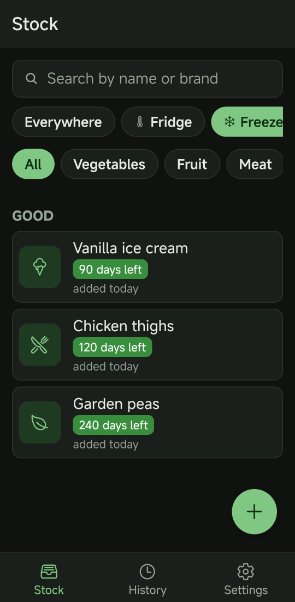
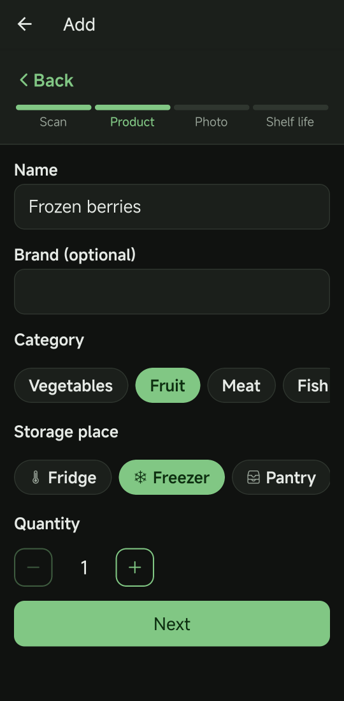
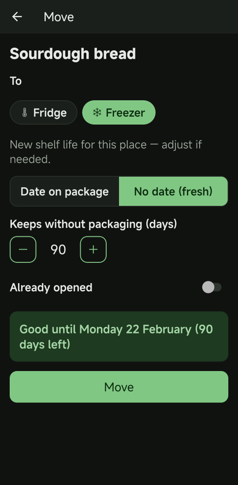
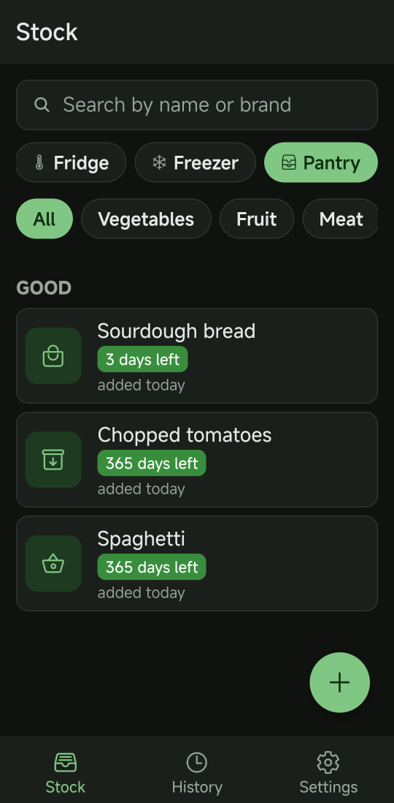
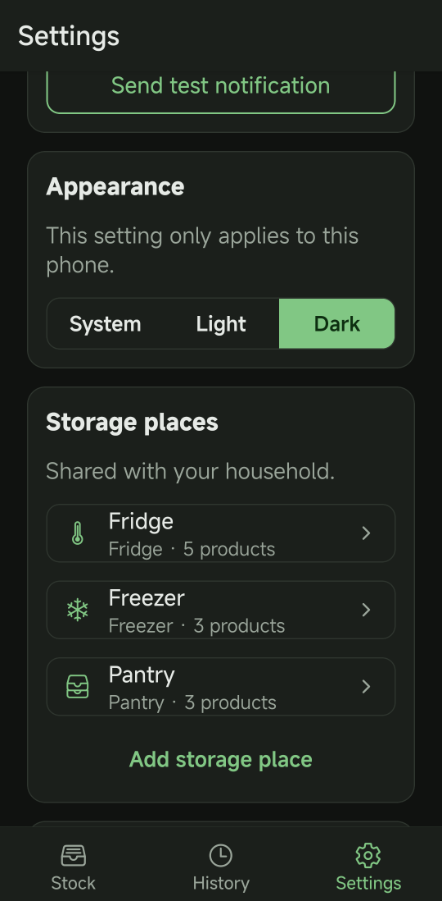
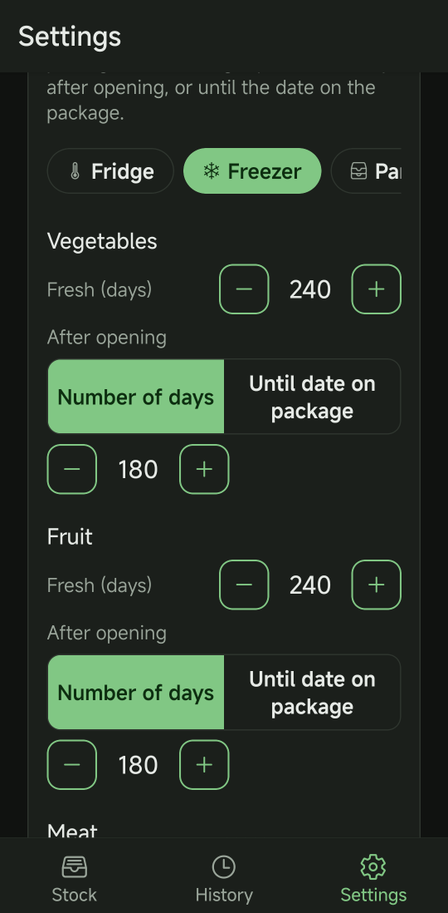
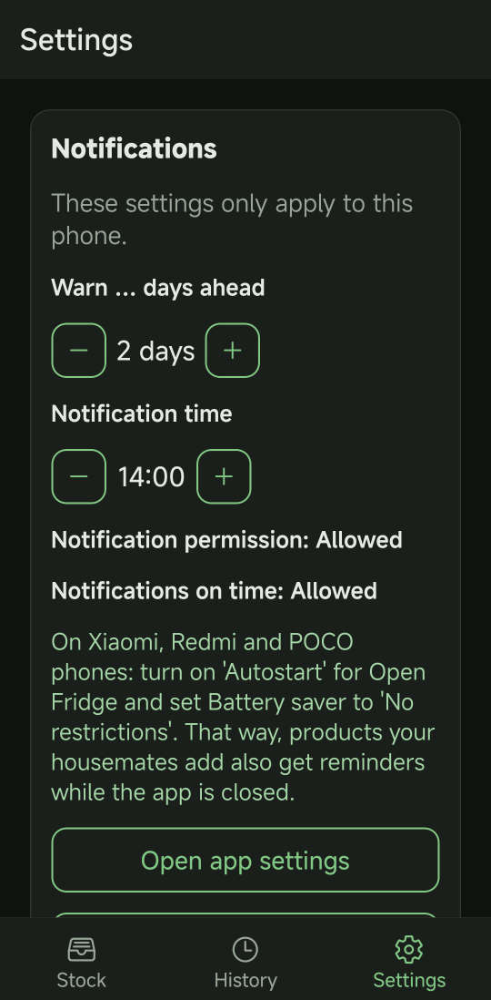

# Open Fridge

Open Fridge is an Android app that keeps track of the food in your home: in the fridge, the freezer, the pantry, the cellar or wherever you keep it. You scan a product's barcode, take a photo, enter the date printed on the package, and the app warns you before the food goes off. Everyone in a household shares the same stock, each on their own phone.

Android only (iOS is not configured or tested). The interface is in Dutch, English, French and German and follows the phone's language.

<p>
  
  
  
</p>

## Features

- **Storage places.** A household can have several fridges, freezers, pantries, cellars, storage rooms or other places (for example a fridge in the kitchen and one in the garage). The stock list has a chip per place to filter on, and each product shows where it is.
- **Moving products.** Move a product to another place in a few taps. Moving it to a different kind of place (fridge to freezer, for instance) proposes a new shelf life for that place, which you can adjust before you confirm.
- **Barcode scanning.** The product name, brand and picture are looked up on Open Food Facts, in the language of the phone where available.
- **Photos** of each product.
- **Shelf life.** Use the date printed on the package, or a number of days for fresh products and opened packages. Every kind of place has its own default number of days per category (meat keeps 2 days in a fridge and 4 months in a freezer), and you can change these defaults for your household. For opened packages you can also choose "until the date on the package".
- **Categories:** vegetables, fruit, meat, fish, dairy, cheese, leftovers, sauces, drinks, dry goods, canned & jarred, bread & bakery, ready meals, snacks & sweets and other.
- **Status at a glance.** The list is sorted by expiry date and uses colours to show the status of each product.
- **Reminders on time.** Local notifications before a product expires. You choose how many days before and at what time, per phone. Notifications name the place when you have more than one.
- **History** of what was eaten and what was thrown away in the last 30 days.
- **Households.** Several phones share one household using a 6-character invite code. Data is stored in Supabase (accounts, database with row-level security, realtime updates, private photo storage).
- **Languages:** Dutch, English, French and German, following the system language (or the per-app language on Android 13 and later).
- **Dark mode:** System, Light or Dark, chosen per phone.

<p>
  
  
  
</p>

## What it costs

For normal household use, nothing.

- **Supabase** (database, accounts, photo storage): the free plan needs no payment card. It includes about 500 MB of database and 1 GB of file storage. Free projects are paused after about a week without activity. If that happens, open the Supabase dashboard and click the restore button. No data is lost.
- **Open Food Facts** (product data): free, and no API key is needed.
- **Notifications**: they are created on each phone. No push notification service is used, so there is nothing to pay for.
- **EAS Build** (building the APK in the cloud): the free Expo plan includes a limited number of builds per month.

## Build your own copy

These steps assume you have never built an app before. You will end up with an APK file (an installable Android app) that talks to your own free Supabase project.

### 1. What you need

- [Node.js](https://nodejs.org) (the LTS version)
- [git](https://git-scm.com)
- A free [Supabase](https://supabase.com) account
- A free [Expo](https://expo.dev) account
- An Android phone

Windows note: if PowerShell says that running scripts is disabled when you use `npx`, type `npx.cmd` instead of `npx` in every command below.

### 2. Get the code

```bash
git clone https://github.com/opivankristovi/open-fridge.git
cd open-fridge
npm install
```

### 3. Set up Supabase

1. In Supabase, create a new project. Pick any name and region, and save the database password somewhere safe.
2. Open **SQL Editor** in the left menu. Open the file `supabase/migrations/0001_init.sql` from this repository, copy all of it, paste it into the editor and click **Run**. It creates the tables, the security rules and the private `photos` storage bucket. Then do the same with `supabase/migrations/0002_storage_locations.sql`, which adds storage places. Run each file once, in this order.

   Already running an older version of Open Fridge (fridge only)? Run only `0002_storage_locations.sql`. Your existing products are kept and placed in a fridge. Then install the new app on **every** phone of a household before anyone in that household uses the new categories (dry goods, canned & jarred, bread & bakery, ready meals, snacks & sweets): older app versions crash on products in those categories. Other households are not affected.
3. Go to **Authentication**, then **Sign In / Providers**, then **Email**, and turn **off** "Confirm email". The app has no screen for handling confirmation links. With the setting on, the link in the email opens `localhost` on your phone and fails. Turning it off is safe: row-level security means an account can only see the households it belongs to, so a fake email address gives access to nothing.
4. Go to **Project Settings**, then **API Keys**, and note two values:
   - **Project URL**: the base address, like `https://xxxx.supabase.co`. Do not use the one ending in `/rest/v1/`.
   - **Publishable key**: starts with `sb_publishable_`. If your project shows the older "anon" key instead, that works too.

Warning: never put the **secret** key or the `service_role` key in the app or in `.env`. Those keys bypass all security rules. Only the publishable (anon) key is meant to be inside an app.

### 4. Add your keys

Copy `.env.example` to `.env` and fill in both values:

```
EXPO_PUBLIC_SUPABASE_URL=https://xxxx.supabase.co
EXPO_PUBLIC_SUPABASE_ANON_KEY=sb_publishable_...
```

The `.env` file is listed in `.gitignore`, so it is not committed to git.

### 5. Try it in Expo Go (optional)

1. Install the **Expo Go** app from the Play Store.
2. Start the development server:

   ```bash
   npx expo start
   ```

3. Scan the QR code with Expo Go. The phone and the PC must be on the same Wi-Fi network. If a firewall blocks the connection, try `npx expo start --tunnel`.

Expo Go is fine for trying out scanning, the list and sharing. Background re-sync and some notification behaviour are only reliable in a real build (next step).

### 6. Build an installable APK with EAS

1. Log in to your Expo account:

   ```bash
   npx eas-cli@latest login
   ```

2. Open `app.json` and delete two things. They belong to the original author's Expo account and will make the build fail for you:
   - the line `"owner": "opivankristovi"` (and the comma before it, so the JSON stays valid)
   - the `"eas": { "projectId": "..." }` block inside `"extra"` (keep the rest of `"extra"`)
3. Link the project to your own Expo account:

   ```bash
   npx eas-cli@latest init
   ```

4. Give the build your two Supabase values. The `.env` file is not uploaded to the cloud build, so store them as EAS environment variables for the `preview` environment (the `preview` profile in `eas.json` uses it). Use `--visibility plaintext`, because these values end up inside the app anyway:

   ```bash
   npx eas-cli@latest env:set preview --name EXPO_PUBLIC_SUPABASE_URL --value "https://xxxx.supabase.co" --visibility plaintext
   npx eas-cli@latest env:set preview --name EXPO_PUBLIC_SUPABASE_ANON_KEY --value "sb_publishable_..." --visibility plaintext
   ```

   Older versions of EAS CLI call this command `env:create` (same arguments).
5. Start the build:

   ```bash
   npx eas-cli@latest build -p android --profile preview
   ```

   The build runs in the cloud and can take several minutes. When it finishes, EAS prints a link. Open it and download the `.apk`.

Optional: the app's Android package name is `be.openfridge.app` (`android.package` in `app.json`). Change it if you want your build to be installable next to someone else's build of the same app. Do this before the first build.

## Installing the APK on a phone

For the people who will use the app:

1. Copy or download the `.apk` file to the phone and open it from the Files app.
2. When Android asks, allow "install unknown apps" for the app you opened the file from (for example Files or Chrome).
3. If Google Play Protect warns about an unknown developer, tap **More details**, then **Install anyway**.

A newer APK of the same build installs over the old one as an update: you stay logged in and keep your settings. This only works when both APKs were signed with the same key (the same EAS project). Some of the warnings above can appear again.

First use:

1. Create an account with any email address and a password.
2. One person creates a household. Everyone else chooses **Join with a code** and types the 6-character code shown in **Settings** on the first phone.
3. Allow the camera when you add your first item, and allow notifications. Without that permission there are no expiry warnings.
4. In **Settings**, tap **Allow** under "Notifications on time" and switch on "Allow setting alarms and reminders". Without it, Android (14 and later) may deliver reminders up to an hour late.
5. On Xiaomi, Redmi and POCO phones, also turn on **Autostart** for Open Fridge and set the battery saver to **No restrictions** (Settings shows a button that opens the right screen). Reminders work without it, but the background refresh that picks up products your housemates add while the app is closed may be blocked.
6. Add more storage places (freezer, pantry, and so on) under **Settings > Storage places**. A new household starts with one fridge.

<p>
  
</p>

## How it works

For developers.

### Data model (Supabase)

The schema is in `supabase/migrations/0001_init.sql` and `supabase/migrations/0002_storage_locations.sql`.

- `households`: name and invite code.
- `household_members`: which user belongs to which household (role `owner` or `member`).
- `storage_locations`: the places where food is kept (fridge, freezer, pantry, cellar, storage room, other). Every item in stock lives in exactly one location.
- `items`: the products in stock, each in a storage location, including status (`in_fridge`, `consumed`, `discarded`), expiry date, opened date and shelf-life days.
- `household_products`: a shared memory of products by barcode.
- `household_settings`: per-household shelf-life defaults per kind of storage location and category, stored as JSON.

Security:

- Row-level security is on for every table. A row is visible only to members of its household, checked by the security-definer function `is_member(household_id)`.
- Households are created and joined only through the functions `create_household`, `join_household` and `regenerate_invite_code`. Direct inserts into `households` and `household_members` are not allowed.
- Photos go in the private `photos` bucket at the path `{household_id}/{item_id}.jpg`. Storage policies check that the first path segment is a household you belong to.
- Realtime is enabled on `items` and `storage_locations`, so other phones see changes immediately.
- Storage places are deleted only through the function `delete_storage_location`, which first moves the products still in stock to another place. The last place of a household cannot be deleted.
- Items can only point to a storage place of their own household (composite foreign key). A database trigger puts items without a place (for example from an older app version) in the household's first fridge.

### Expiry and notifications

- The expiry date of an item is the earliest of: the printed date, the opened date plus the days after opening, and the date it was stored in its current place plus the days for fresh products. Moving a product to another kind of place restarts those clocks (`stored_at`). See `src/domain/expiry.ts`.
- Default shelf life comes from a table per kind of place and category (`src/domain/shelfLife.ts`), overridden per household in `household_settings.shelf_defaults`.
- Notifications are scheduled locally on each phone as exact alarms (with the "Alarms & reminders" permission). They are re-planned when the app starts, when it comes to the foreground, when items change, and about every 12 hours by a background task (`expo-background-task`). Re-planning only adds new and removes outdated reminders, so a reminder that is due but not yet delivered is never lost. See `planResync` in `src/services/schedule.ts`.

### Project structure

```
src/
  app/          screens and navigation (Expo Router): login, register, household, tabs, add, item
  components/   reusable UI parts
  data/         Supabase queries, React Query hooks, realtime, local preferences
  domain/       plain logic without UI: expiry rules, shelf-life table, categories, storage places, formatting
  services/     Open Food Facts lookup, photos, notifications, scheduling, background sync
  auth/         login state
  lib/          Supabase client, query client, error helpers
  i18n/         texts in Dutch (source), English, French and German; language detection
  types/        database types
  theme.ts      light and dark colours
supabase/
  migrations/   database setup SQL
docs/
  screenshots/  images used in this README
```

## Development

```bash
npx tsc --noEmit      # type check
npx jest              # unit tests
npx expo lint         # lint
npx expo-doctor       # check dependencies and config
```

Add packages with `npx expo install <package>` instead of `npm install <package>`. It picks the version that matches the Expo SDK (this project uses Expo SDK 58).

## Licence

Open Fridge is free software, released under the GNU General Public License version 3 or later (GPL-3.0-or-later). See the `LICENSE` file.

Copyright (C) 2026 opivankristovi

Product data comes from [Open Food Facts](https://world.openfoodfacts.org), which is available under the Open Database License (ODbL).
